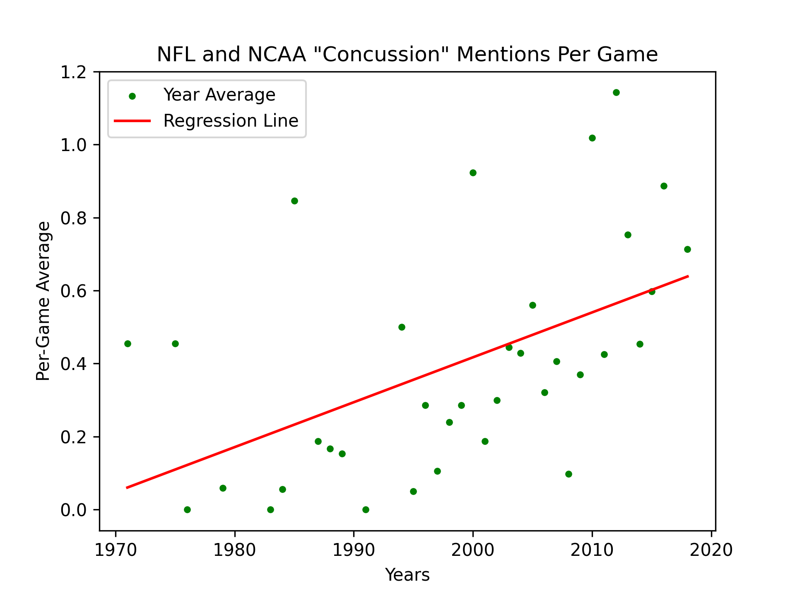

# Football Broadcast Transcript Analysis

This codebase analyzes the long term trends of the frequency a specific phrase
is said in both NFL and college football broadcasts. Specifically, it analyzes
over the years how often per-game broadcast a phrase is said. 

The main Python script `analyze.py` generates a scatter plot and a table for a
given target phrase. The scatter plot displays the yearly per-game broadcast
average a provided target phrase is said. It also displays a regression line
demonstrating the linear trend. The table is written to a CSV file and details
for each year the total number of times the target phrase is said, the number
of game broadcasts in the dataset for that year, and the per-game broadcast
target phrase average.

### Outline
* [Dataset Download](#dataset-download)
* [Environment Setup](#environment-setup)
* [Usage](#usage)

## Dataset Download
The broadcast transcript dataset is sourced from Merullo et al.'s paper which
was published in EMNLP [1]. It contains both NFL and college (NCAA) football
broadcast transcripts between 1962 and 2018; dataset size information
[here](./dataset_size.csv).

Download the 1.4G dataset from: 
> https://drive.google.com/file/d/15XVD0kumvPhJkwj20an2kwWCdL9w_cy7/view?usp=sharing

Move the downloaded zip file to this project and unzip it. For example, on
computers running MacOS:
```bash
cd football-transcripts
mv Downloads/dataset.zip .
unzip dataset.zip
rm -f dataset.zip
```

The downloaded zip file should have the name `dataset.zip` so when it is
expanded it will be saved to a directory titled `dataset`. The code assumes the
dataset is in folder `dataset/`. If you want to rename the directory, change
the value of variable `DATA_PATH` in [analyze.py](./analyze.py).

The only file needed from the dataset is `raw_transcripts.json` (136M).

## Environment Setup
Minimum required Python version is 3.10. Run the following command to install
third-party packages used in Python analysis.
```bash
pip install -r requirements.txt
```

## Usage
File `analyze.py` runs the analysis described above. It generates analysis for
three dataset subsets. 
1. NFL broadcasts only
2. College football broadcasts only
3. The entire dataset: both NFL and college football broadcasts

Each subset has its own CSV file and scatter plot image; each execution
creates 6 files. 

```
python3 analyze.py <phrase> <-sample>
```
* `<phrase>`: Target phrase to run analysis for. Phrase is not case sensitive;
  the code automatically lowercases all processed transcripts and the provided
  phrase. For phrases longer than one word, write a backslash before any space.
  For example, for "first down" write "first\ down". No text is removed from
  the raw transcripts.
* `<-sample>`: Optional argument setting the sample size requirement for the
  minimum number of broadcast transcripts in a year to plot that point on the
  scatter plot. Default value is 5. This argument has no effect on the table
  written to the CSV file. 

Execution results are written to directory `output/<phrase>-n=<sample>/`.

The code defaults to not plot the one broadcast transcript in 1962 because
there is a seven year gap between it and the next year with a broadcast (see
[dataset_size.csv](./dataset_size.csv)). To avoid the large gap in the plot, it
defaults to not show it. To change this, set variable `NO_PLOT_1962` to `False`
in [analyze.py](./analyze.py). Also, if `-sample` is set to a number larger
than 1, this point will not be plotted no matter the value of `NO_PLOT_1962`. 

### Example Usage
For example, if you want to see how awareness of concussions on football
broadcasts has changed over the years, you can run the following command.
```bash
python3 analyze.py concussion -sample 10
```
It creates three CSV files and three scatter plot images. The NFL and college
football combined broadcast scatter plot looks as follows:



See directory [example_output/](./example_output/) to examine all six files.


## References
[1] Merullo, J., et al. (2019). "Climate Dynamics." *Empirical Methods in
Natural Language Processing*. https://doi.org/10.18653/v1/D19-1666